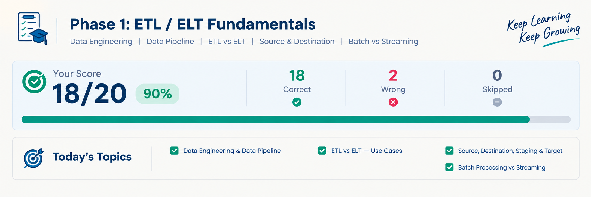

# ETL vs ELT Fundamentals

  

## Advanced Scenario-Based Assessment

**Topic:** ETL, ELT, Data Pipelines, Batch Processing, and Streaming  
**Assessment Type:** Scenario-Based Logical Reasoning  
**Total Questions:** 20  
**Correct Answers:** 18
**Incorrect Answers:** 1  
**Final Score:** 18/20 (90%)

---

## 1. What I Practiced

In this assessment, I tested my understanding of ETL and ELT fundamentals through scenario-based questions rather than relying only on definitions.

The main objective was to understand how data engineering concepts work in practical situations and how to select the appropriate approach based on data flow, transformation requirements, storage architecture, and processing frequency.

### Topics Covered

- Data Engineering fundamentals
- Data pipelines and their workflow
- ETL (Extract, Transform, Load)
- ELT (Extract, Load, Transform)
- Data sources and target systems
- Staging areas and raw data storage
- Batch processing
- Stream processing
- Transformation before and after loading
- Scenario-based pipeline design
- Logical reasoning for selecting data processing strategies

## 2. Exam Results

| Assessment Metric | Result |
|---|---:|
| Total questions | 20 |
| Correct answers | 19 |
| Incorrect answers | 1 |
| Accuracy | 95% |
| Final score | 19/20 |

**Result:** 95% accuracy in an advanced, scenario-based ETL/ELT assessment.

This result demonstrates a strong understanding of the tested fundamentals. However, one incorrect answer revealed an area that needs further practice: identifying the correct combination of transformation strategy and processing frequency from a real-world scenario.

---

## 3. Questions, My Answers, and Correct Answers

### Question 01 — ETL Fundamentals

**Question:** What does ETL stand for?

- A. Extract, Transfer, Load
- B. Evaluate, Transform, Link
- C. Extract, Transform, Load
- D. Export, Track, Load

**My Answer:** C  
**Correct Answer:** C — Extract, Transform, Load

**Explanation:** ETL extracts data from a source, transforms it before loading, and then loads the processed data into the target system.

**Result:** Correct

### Question 02 — ELT Fundamentals

**Question:** What is the main difference between ETL and ELT?

- A. ELT never transforms data.
- B. ETL transforms data before loading, while ELT transforms data after loading.
- C. ETL only works with streaming data.
- D. ELT does not require a data destination.

**My Answer:** B  
**Correct Answer:** B

**Explanation:** In ETL, transformation happens before loading into the target. In ELT, raw data is loaded first and transformed afterward, commonly within a data warehouse or data platform.

**Result:** Correct

### Question 03 — Data Pipeline

**Question:** What is the primary purpose of a data pipeline?

- A. To design website interfaces
- B. To replace every database
- C. To move and process data between systems
- D. To eliminate the need for data storage

**My Answer:** C  
**Correct Answer:** C

**Explanation:** A data pipeline automates the movement and processing of data from sources to destinations.

**Result:** Correct

### Question 04 — Transformation in ETL

**Question:** In a traditional ETL workflow, when does transformation occur?

- A. Before extraction
- B. After extraction and before loading
- C. Only after loading
- D. Only when a report is generated

**My Answer:** B  
**Correct Answer:** B

**Explanation:** ETL follows the sequence Extract → Transform → Load.

**Result:** Correct

### Question 05 — Transformation in ELT

**Question:** In an ELT workflow, where does transformation commonly occur?

- A. Only in the source application
- B. Before the data is extracted
- C. After raw data has been loaded into the target platform
- D. Before any data is collected

**My Answer:** C  
**Correct Answer:** C

**Explanation:** ELT loads the extracted data first. Transformations are performed afterward, often using the processing capabilities of the destination platform.

**Result:** Correct

### Question 06 — Data Source

**Question:** Which of the following can be a data source?

- A. Only a spreadsheet
- B. A database, API, CSV file, or application
- C. Only a data warehouse
- D. Only a dashboard

**My Answer:** B  
**Correct Answer:** B

**Explanation:** Data sources can include relational databases, APIs, files, application logs, event streams, and many other systems.

**Result:** Correct

### Question 07 — Data Destination

**Question:** What is the role of a target or destination in a data pipeline?

- A. To generate source data exclusively
- B. To receive and store or serve pipeline output
- C. To prevent all transformations
- D. To replace data quality checks

**My Answer:** B  
**Correct Answer:** B

**Explanation:** A destination may be a database, data warehouse, data lake, analytics platform, or another system that receives pipeline data.

**Result:** Correct

### Question 08 — Staging Area

**Question:** What is a staging area used for in data engineering?

- A. To temporarily hold data during processing
- B. To permanently replace every source system
- C. To display charts only
- D. To eliminate the need for extraction

**My Answer:** A  
**Correct Answer:** A

**Explanation:** A staging area can temporarily store extracted data before further validation, transformation, or loading. Its exact role depends on the architecture.

**Result:** Correct

### Question 09 — Batch Processing

**Question:** Which scenario is the best example of batch processing?

- A. Processing every event immediately as it arrives
- B. Processing accumulated sales records once every night
- C. Updating a dashboard for every incoming event
- D. Continuously evaluating sensor readings

**My Answer:** B  
**Correct Answer:** B

**Explanation:** Batch processing handles a collection of data at scheduled intervals or when a batch is ready.

**Result:** Correct

### Question 10 — Stream Processing

**Question:** Which scenario best represents stream processing?

- A. Generating a report once a month
- B. Processing incoming events continuously as they arrive
- C. Loading a CSV file every Sunday
- D. Running a yearly database migration

**My Answer:** B  
**Correct Answer:** B

**Explanation:** Stream processing handles continuously arriving events with low latency, although the exact processing delay depends on the system.

**Result:** Correct

### Question 11 — Choosing ETL

**Question:** An organization must clean and standardize sensitive data before it enters the target system. Which approach may be appropriate?

- A. ELT is mandatory in every situation.
- B. ETL, if transformation must occur before loading into the target.
- C. Streaming is always required.
- D. Data pipelines cannot perform this task.

**My Answer:** B  
**Correct Answer:** B

**Explanation:** ETL can be suitable when data must be filtered, masked, validated, or transformed before it reaches the target. The final choice also depends on security requirements and architecture.

**Result:** Correct

### Question 12 — Choosing ELT

**Question:** A cloud data warehouse can store raw data and perform transformations using its own computing resources. Which approach may be suitable?

- A. ETL is the only possible option.
- B. ELT, where raw data is loaded before transformation.
- C. No pipeline is needed.
- D. Streaming must be used regardless of the requirements.

**My Answer:** B  
**Correct Answer:** B

**Explanation:** ELT can take advantage of the destination platform's processing capabilities and preserve raw data for future transformations.

**Result:** Correct

### Question 13 — Data Quality

**Question:** Why are data validation and quality checks important in a pipeline?

- A. They make all databases unnecessary.
- B. They guarantee that data never changes.
- C. They help detect invalid, missing, inconsistent, or unexpected data.
- D. They eliminate the need for monitoring.

**My Answer:** C  
**Correct Answer:** C

**Explanation:** Data quality checks help identify issues such as missing values, invalid formats, duplicate records, and unexpected values before they affect downstream systems.

**Result:** Correct

### Question 14 — Pipeline Scheduling

**Question:** A company processes yesterday's transactions every morning at 2:00 AM. Which processing pattern does this most closely represent?

- A. Continuous streaming
- B. Scheduled batch processing
- C. Real-time event processing
- D. Manual-only data entry

**My Answer:** B  
**Correct Answer:** B

**Explanation:** The pipeline runs at a scheduled time and processes a collection of previously accumulated transactions, making it a batch workflow.

**Result:** Correct

### Question 15 — Raw Data Preservation

**Question:** Why might a data engineering team preserve raw data before applying transformations?

- A. To make data processing impossible
- B. To remove all historical information
- C. To prevent any future schema changes
- D. To support reprocessing, auditing, and alternative transformations

**My Answer:** D  
**Correct Answer:** D

**Explanation:** Retaining raw data can make it possible to rebuild transformed datasets, investigate errors, and apply new business rules without collecting the original data again—subject to retention, privacy, and security requirements.

**Result:** Correct

### Question 16 — ETL Workflow

**Question:** Which sequence correctly represents ETL?

- A. Transform → Extract → Load
- B. Extract → Transform → Load
- C. Load → Extract → Transform
- D. Extract → Load → Transform

**My Answer:** B  
**Correct Answer:** B

**Explanation:** ETL transforms the extracted data before loading it into the target.

**Result:** Correct

### Question 17 — ELT Workflow

**Question:** Which sequence correctly represents ELT?

- A. Extract → Load → Transform
- B. Transform → Extract → Load
- C. Load → Transform → Extract
- D. Transform → Load → Extract

**My Answer:** A  
**Correct Answer:** A

**Explanation:** ELT extracts data, loads it into the target platform, and then performs the required transformations.

**Result:** Correct

### Question 18 — Advanced Scenario: ELT vs. Streaming

**Question:** A company loads raw application data into a cloud data warehouse first. It transforms the data inside the warehouse and runs the pipeline once daily. Which combination best describes this architecture?

- A. ELT + Batch Processing
- B. ETL + Streaming
- C. ETL + Batch Processing
- D. ELT + Streaming

**My Answer:** B  
**Correct Answer:** A — ELT + Batch Processing

**Explanation:** This was the only incorrect answer in the assessment.

The scenario contains two independent clues:

1. **Raw data is loaded first, then transformed inside the warehouse.** This indicates ELT.
2. **The pipeline runs once daily.** This indicates scheduled batch processing.

Therefore, the correct combination is **ELT + Batch Processing**.

**What I learned:** ETL/ELT describes *when transformation occurs relative to loading*, while batch/streaming describes *how and when data is processed*. These are separate dimensions, so they must be evaluated independently.

**Result:** Incorrect

### Question 19 — Pipeline Reliability

**Question:** Why should a production data pipeline include logging and monitoring?

- A. To guarantee that no failure can ever happen
- B. To help detect failures, investigate problems, and track pipeline behavior
- C. To eliminate the need for data storage
- D. To ensure that all data is processed manually

**My Answer:** B  
**Correct Answer:** B

**Explanation:** Logging and monitoring help teams identify failures, understand pipeline execution, measure performance, and troubleshoot data quality or operational issues. They do not guarantee that failures will never occur.

**Result:** Correct

### Question 20 — Selecting a Processing Strategy

**Question:** A business needs continuously updated results from incoming transactions instead of waiting for a nightly run. Which processing approach is the strongest starting point?

- A. Monthly batch processing
- B. Annual data processing
- C. Stream processing
- D. Manual spreadsheet updates

**My Answer:** C  
**Correct Answer:** C

**Explanation:** Stream processing is a suitable starting point when incoming events must be processed continuously and results need to be updated with low latency. The final architecture depends on the actual latency and reliability requirements.

**Result:** Correct

---

## 4. Performance Analysis

### What I demonstrated

- I correctly identified the fundamental ETL and ELT workflows.
- I distinguished data sources, destinations, and staging areas.
- I recognized the difference between batch and stream processing.
- I applied data engineering concepts to practical scenarios.
- I understood why data validation, raw data preservation, logging, and monitoring matter.
- I correctly answered 19 of the 20 questions.

### What I need to improve

My only mistake involved combining two separate concepts into one answer.

I need to consistently evaluate:

1. **Transformation strategy:** Does transformation happen before loading or after loading?
2. **Processing pattern:** Is data processed on a schedule or continuously as it arrives?

These concepts are related to pipeline design, but they answer different questions.

---

## 5. Key Concepts Reinforced

| Concept | Core understanding |
|---|---|
| ETL | Extract → Transform → Load |
| ELT | Extract → Load → Transform |
| Batch processing | Processes data in scheduled or accumulated groups |
| Stream processing | Processes continuously arriving events |
| Staging area | Temporarily holds data during a workflow |
| Data validation | Checks whether data meets defined quality rules |
| Raw data preservation | Supports reprocessing and auditing |
| Logging and monitoring | Helps detect, investigate, and troubleshoot pipeline issues |

**Important distinction:** ETL and ELT are transformation/loading strategies. Batch and streaming are processing patterns. A system can combine these concepts in different ways depending on its requirements.

---

## 6. Final Reflection

This assessment helped me move beyond memorizing definitions and practice interpreting real-world data engineering scenarios.

Achieving **19/20 (95%)** shows strong performance on the concepts covered in this test. More importantly, the incorrect answer identified a specific weakness that I can address through further scenario-based practice.

My next goal is to strengthen my understanding of data pipeline architecture, transformation strategies, processing patterns, and the practical trade-offs involved in designing reliable data systems.

**Learning principle:** I want to understand not only what a data engineering concept means, but also when, why, and how it should be used in a real system.

**Next step:** Practice harder scenario-based questions involving ETL/ELT, batch versus streaming, incremental loading, data quality, idempotency, orchestration, and pipeline failure recovery.
